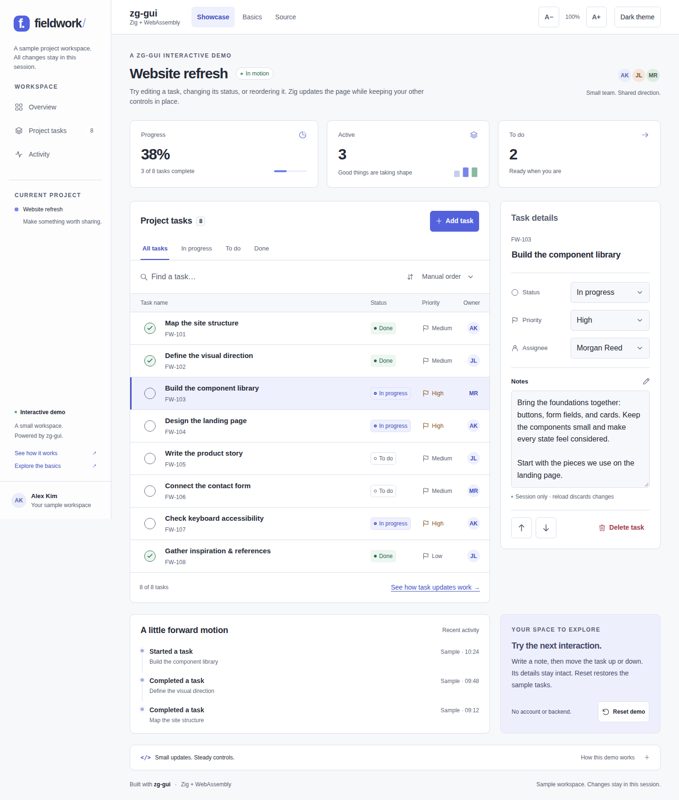

# zg-gui

A compact Zig/WebAssembly GUI framework with HTML-like templates compiled into
Zig. Application state and rendering decisions live in Zig; a small JavaScript
host applies precise DOM updates and forwards declared events.

**Small updates. Steady controls.** Keyed rows, editable forms, and focused inputs
keep their DOM identity across updates and reordering.



[Watch the interaction demo](docs/images/workspace-demo.webm) ·
[Mobile screenshot](docs/images/workspace-mobile.png) ·
[Dark theme](docs/images/workspace-dark.png) ·
[Source walkthrough](docs/workspace-showcase.md)

## Try the workspace

Build on Linux with the Zig compiler in [`.zigversion`](.zigversion). On the
first build, Zig fetches the pinned SuperHTML template tokenizer and `zig-cdp`
browser tooling.

```sh
zig build serve
```

Open **http://127.0.0.1:4180**. Stop the server with Ctrl+C.

Fieldwork is a complete, synthetic project workspace. Edit task names and notes,
change status and priority, assign teammates, search, filter, sort, reorder, add
and delete tasks. Progress, an SVG status chart, and recent activity update from
the same Zig state. Light/dark themes and a responsive layout work on desktop
and mobile. Use **A− / A+** in the top bar to adjust text size from 80% to 140%.
The three overview cards share one compiled template component.

No account, backend, external assets, or runtime npm dependencies. Workspace
changes survive page navigation and reloads within the same browser tab.
**Reset demo** restores the sample. Your theme preference is saved across
Showcase, Basics and Source. The example holds up to 24 tasks. Open **How this demo works** for a quick explanation and a
source walkthrough. Use the shared **Showcase / Basics / Source** navigation
on any screen size. The introductory **/basics.html** demo includes guided
experiments for live inputs, retained rows and independent component choices.

## A template, a typed view, a small host

```html
<input :value="$name" :input="$inputs.name">
<ul :loop="$rows" :key="id" :limit="24">
  <li><span :text="$item.label"></span></li>
</ul>
```

The native compiler validates templates and generates stable identities and typed
projection code. The browser receives escaped initial HTML, followed by text,
attribute, form-value, focus, and structural commands. There is no runtime
template parser or virtual DOM.

- Caller-owned, bounded HTML and patch buffers with explicit failure admission.
- Property snapshots and keyed child lists with retained row identity.
- Reusable template components, scoped namespaces, and typed child slots.
- Controlled inputs/selects, SVG, table fragments, and numeric CSS variables.
- UTF-8 exchange, mount/dispose lifecycle, and explicit recovery after bad patches.

Start with the [template guide](docs/templates.md),
[integration and ownership](docs/integration.md), and
[command protocol](docs/protocol.md). The [roadmap](docs/roadmap.md) documents
capabilities and limits, including unsupported nested keyed loops and multiple
selection. Consumer state, effects, routing, styling, and application policy
remain outside the framework.

Optional [diagram projections](docs/diagrams.md) add flowcharts, sequence diagrams
and SVG export through a caller-selected layout engine. Run
`zig build serve -Ddiagrams=true` and open **http://127.0.0.1:4180/diagrams.html**
for the two-source example. Core-only builds keep the engine dependency unused.

## Explore the example

| File | Responsibility |
| --- | --- |
| [workspace.zig](examples/workspace.zig) | Owned state, validation, view derivation, actions, ABI, native tests |
| [workspace.gui.html](examples/workspace.gui.html) | Workspace layout, forms, keyed task and activity lists |
| [workspace-metric.gui.html](examples/workspace-metric.gui.html) | Reusable summary card and SVG status chart |
| [workspace.css](examples/web/workspace.css) | Responsive layout, visual design, themes |
| [workspace.js](examples/web/workspace.js) | Loading the public browser runtime |
| [workspace_tests.zig](tools/browser/workspace_tests.zig) | Browser checks for the WASM workspace, DOM identity, and focus |

`zig build` produces the complete static site in **zig-out/web**. All application
assets use relative paths, including beneath a repository subpath. See the
[showcase guide](docs/workspace-showcase.md) for hosting and reproducible checks.

## Verify

Install Chrome or Chromium on Linux for the native browser checks. The
[CDP guide](tools/lib/README.md) lists the supported browser locations.

```sh
zig build test
zig build test-browser
```

`zig build test` runs the native framework, template compiler, workspace, and
tool tests. The browser suite checks the examples, recovery, retained DOM
objects, focus, selection, desktop/mobile layout, and generated-template edge
cases through `cdp`.

The [showcase guide](docs/workspace-showcase.md#measurements) records artifact
size, memory, and representative patch work. These are example measurements,
not consumer budgets or peak-memory guarantees.

Framework changes follow [neutral capability requests](docs/contributing.md).
Provider verification and consumer application acceptance remain separate.

The optional diagram example pins reviewed engine source and file digests under
`vendor/diagram_engine`; it needs no sibling engine checkout. Verify it with
`zig build verify-diagram-engine`. See [diagram dependency maintenance](docs/diagrams.md#pinned-example-engine).

Numerical [chart helpers](docs/charts.md) provide linear/band scales, ticks,
axes and clipped line/bar geometry without an engine or allocator. Run
`zig build serve` and open `/charts.html` for the editable SVG/table example.
