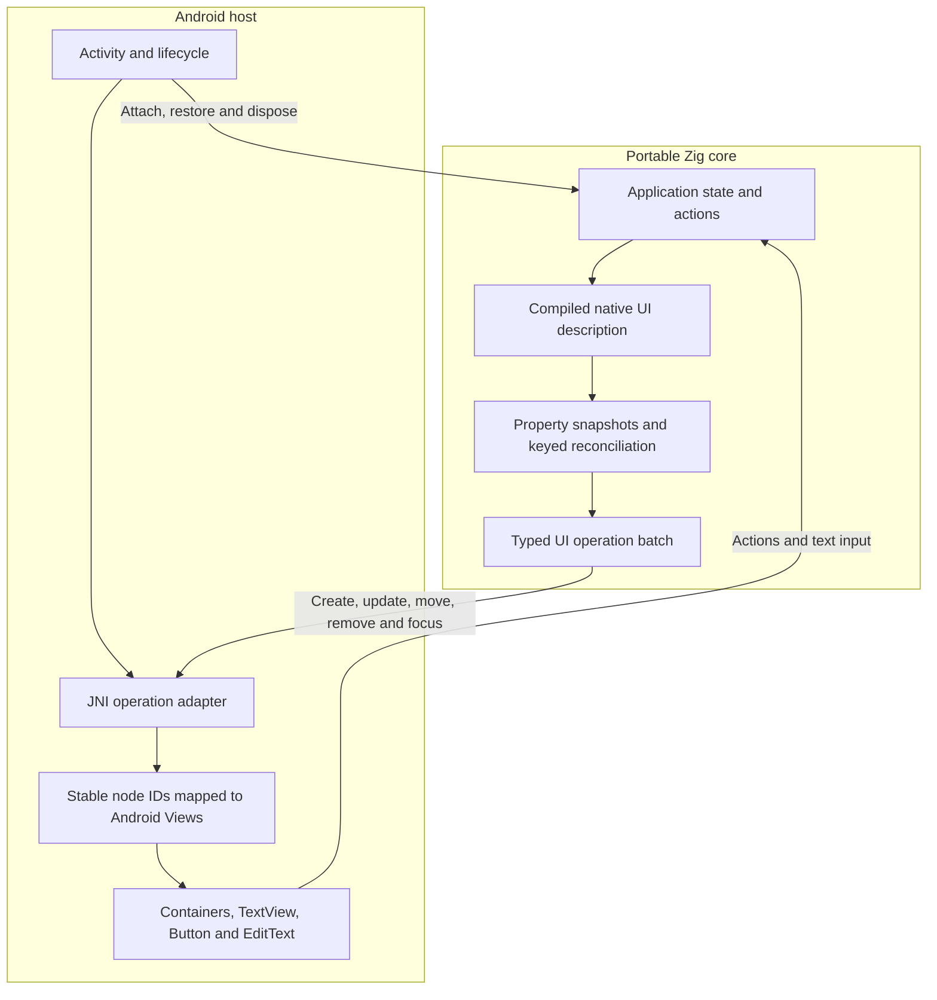

# Native Android backend with a small platform layer

Status: proposed capability. No native Android UI backend is implemented or
verified by this document.

## Reusable problem

Applications need to use the zg-gui design in native Android code: Zig owns
application state and rendering decisions, stable node identities identify
controls, and incremental operations update the smallest affected UI owner.
The native host forwards actions and text input to Zig.

The existing browser backend delegates layout, text, controls and accessibility
to the browser. A small native platform layer is feasible when Android widgets
provide those services. Its size depends on the supported widget and property
set; a small adapter does not establish a binary-size or memory guarantee.

## Backend choice

| Approach | Platform layer | Shared framework responsibility |
| --- | --- | --- |
| Android widgets | Activity, JNI bridge, node registry and widget operations | Typed UI descriptions, property snapshots, reconciliation and event contracts |
| Shared custom renderer | Drawing surface, lifecycle, input and system services | Layout, text shaping, drawing, hit testing, controls, scrolling and accessibility integration |

Start with Android widgets and a bounded set of row/column containers, labels,
buttons and text fields. Android supplies widget layout, drawing and editing
behavior. A shared renderer is a separate capability if consistent custom
drawing across platforms becomes a requirement.

## Proposed architecture

The diagram describes the proposed Android-widget backend.

The native Zig application core would normally be built as an Android ABI
shared library (`.so`) and packaged in an APK with an Activity, manifest and
resources. JNI connects the native library to the Android host. See
[Android NDK concepts](https://developer.android.com/ndk/guides/concepts).

Use a small Kotlin/Java Activity for the initial widget backend. Android's
[native-activity sample guidance](https://github.com/android/ndk-samples/blob/main/native-activity/README.md)
recommends an Activity with JNI for ordinary applications. Apply Android View
changes on the UI thread and keep long-running application work off that thread,
following the [Android threading contract](https://developer.android.com/guide/components/processes-and-threads).

## Reuse and compatibility boundary

Property snapshots, stable IDs, namespaces, bounded output and the principles
of keyed reconciliation can carry over. Existing snapshot helpers are a useful
starting point; Android compatibility still requires an independent build.

The current projection layer emits initial HTML, and the
[DOM command protocol](../protocol.md) uses HTML fragments for child creation
and replacement. Replacing the JavaScript host alone cannot supply a native UI.
A native backend needs explicit node-creation operations and its own compiler
output contract. Existing HTML/CSS templates require defined native mappings;
arbitrary HTML, CSS, SVG and browser behavior are outside the initial scope.

## Public API expectations

These are proposed responsibilities, not available exports. Specify the public
Zig module, compiler entrypoint and versioned C ABI before implementation.

- Use named input structs for node creation, property updates, child placement,
  focus requests and event delivery. Define supported widgets, layout units,
  sizing rules, properties and accessibility metadata explicitly.
- Express initial construction and later changes through typed operations such
  as `create_node`, `set_text`, `set_value`, `move_child`, `remove_node` and
  `focus`. These names are illustrative. Retain widget instances and unaffected
  ancestors when changing a property or reordering keyed children.
- Batch operations across JNI. Define a C-compatible representation with fixed
  tags and fields, explicit string lengths and a version; do not expose Zig
  slices or tagged-union layout as an implicit foreign ABI.
- Identify event targets by node ID and host generation. Define action, text,
  selection and composition payloads. Programmatic updates must not echo as
  user events or unnecessarily reset the active input's caret and composition.
- Keep the native backend optional and document its supported public imports.
  Existing browser consumers must not acquire Android build dependencies.

## Ownership and failure behavior

Consumers own application state, persistence, routing, effects and product
policy. The Zig projection owner holds snapshots and bounded operation storage.
The Android host owns Views, listeners, the node registry and JNI references.
Detach/dispose releases host resources and invalidates events from that host
generation. Activity recreation restores the UI from consumer-owned state;
durable recovery after process death requires consumer persistence.

Start with synchronous batch application. Operation and string storage remains
valid until the host returns; the host copies values it needs to retain. Any
future queued transport must define copying or ownership transfer and an
acknowledgment before the producer reuses storage.

Reject size/count overflow, unknown operations, unsupported properties and
invalid node relationships before applying a batch. Report capacity and native
allocation failures to the caller. Commit the next projection snapshot only
after successful host acknowledgment.

Native API calls can fail after earlier operations have applied. Such a failure
marks the host out of sync, reports the error and stops incremental application
until an explicit rebuild from canonical state succeeds. Do not promise an
atomic widget transaction or hide repeated rebuild failures.

## Acceptance checks

- [ ] Publish the supported widget/layout contract, public Zig API, compiler
  integration and C ABI, verified from an independent consumer package.
- [ ] Build and package a synthetic Android example using the declared NDK,
  Android API level and supported ABIs. Exercise an emulator and physical device.
- [ ] Verify property updates and keyed insertion, deletion and reordering keep
  unaffected View instances, ancestors, focus and selection.
- [ ] Verify Unicode input, IME composition, keyboard show/hide, action delivery,
  accessibility labels and programmatic-update event suppression.
- [ ] Verify attach/dispose, Activity recreation, state restoration, resource
  release and rejection of stale events from a previous host generation.
- [ ] Exercise buffer overflow, invalid operations, capacity exhaustion and
  partial host failure with explicit recovery from canonical state.
- [ ] Confirm browser build isolation and retain existing browser DOM identity
  and focus checks when shared projection or compiler code changes.
- [ ] Record native library and APK sizes, initial and observed peak memory,
  and operation counts/bytes for stated workloads. Separate native, managed and
  process memory measurements; measurements do not authorize optimization or
  changes to consumer budgets.

Provider delivery and consumer application acceptance are tracked separately.
All checks above remain pending; no Android performance or compatibility result
is claimed.
